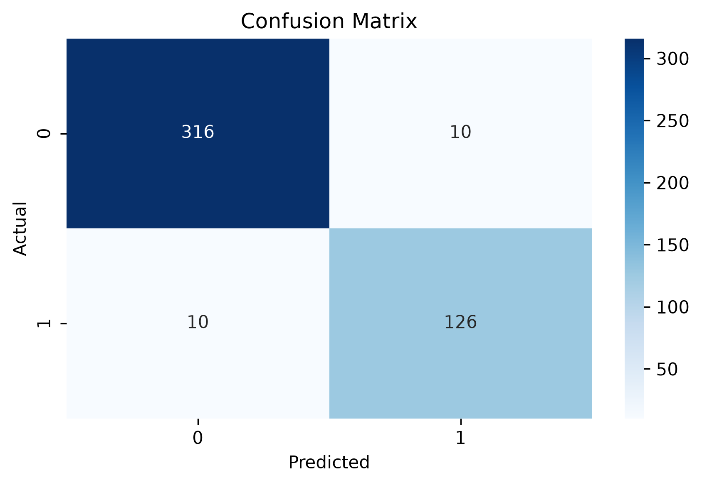
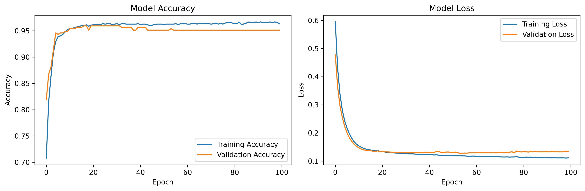

# Deep Learning – Artificial Neural Network (ANN)

This repository contains an individual Deep Learning practical assignment implementing a binary classification model using **Artificial Neural Network (ANN)** with TensorFlow and Keras.

The project follows the practical module from the Deep Learning course at Universitas Airlangga.

## Project Overview

The objective of this project is to build and evaluate an ANN model for binary classification using a dataset provided in Excel format.

The model uses age and features B through M as input variables, while feature N is used as the target variable.

## Technologies & Libraries

- Python 3.11
- TensorFlow & Keras
- Pandas
- NumPy
- Scikit-learn
- Matplotlib
- Seaborn
- OpenPyXL

## Project Structure

```text
Deep_Learning/
│
├── main.py
├── BlaBla.xlsx
├── .gitignore
│
└── results/
    ├── confusion_matrix.png
    └── training_history.png
```

## Methodology

The implementation consists of the following steps:

1. **Import Libraries** – Import the required Python libraries.
2. **Load Dataset** – Read the Excel dataset using Pandas.
3. **Feature and Label Separation** – Use UMUR_TAHUN and columns B–M as input features, and N as the target.
4. **Age Encoding** – Convert age into five categories:
   - 1: Age ≤ 20
   - 2: Age 21–30
   - 3: Age 31–40
   - 4: Age 41–50
   - 5: Age > 50
5. **Data Preprocessing** – Handle missing values and detect outliers using the IQR method.
6. **Data Splitting** – Divide the dataset into 80% training data and 20% testing data.
7. **Feature Scaling** – Apply StandardScaler.
8. **ANN Model Development** – Build a neural network using Keras Sequential.

## ANN Architecture

The model consists of three Dense layers:

| Layer | Neurons | Activation |
|---|---:|---|
| Hidden Layer 1 | 16 | ReLU |
| Hidden Layer 2 | 8 | ReLU |
| Output Layer | 1 | Sigmoid |

### Model Configuration

- Optimizer: Adam
- Loss Function: Binary Crossentropy
- Evaluation Metric: Accuracy
- Epochs: 100
- Validation Split: 0.2

## Experimental Results

Dataset size: **2,308 rows and 15 columns**

| Description | Result |
|---|---:|
| Training Data | 1,846 |
| Testing Data | 462 |
| Test Loss | 0.1557 |
| Test Accuracy | 95.67% |

### Confusion Matrix

The confusion matrix visualizes the classification performance of the ANN model.



### Training History

The following visualization shows the training and validation accuracy and loss throughout the training process.



## Installation and Execution

### 1. Clone Repository

```bash
git clone https://github.com/gefiryaa/Deep_Learning.git
cd Deep_Learning
```

### 2. Create Virtual Environment

```bash
py -3.11 -m venv .venv
```

### 3. Activate Virtual Environment

Windows PowerShell:

```powershell
.\.venv\Scripts\Activate.ps1
```

### 4. Install Dependencies

```bash
pip install numpy pandas seaborn matplotlib scikit-learn tensorflow openpyxl
```

### 5. Run the Program

```bash
python main.py
```

**Note:** Make sure `BlaBla.xlsx` is located in the same directory as `main.py`.

## Author

**Ghefira Nur Ahyan**

D4 Informatics Engineering  
Faculty of Vocational Studies  
Universitas Airlangga

---

*Deep Learning Practical Assignment – 2026*